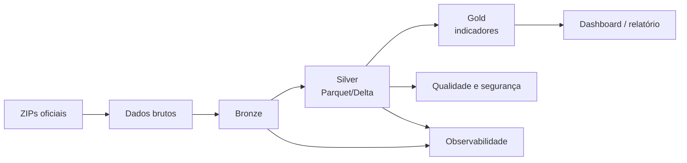

# Plano de Desenvolvimento - Plataforma CNPJ

## Estado atual

O repositório atual é o **repositório inicial** do trabalho. Ele já contém:

- demo local com dados sintéticos;
- fluxo Bronze → Silver → Gold;
- testes automatizados;
- mascaramento de CPF/CNPJ;
- validação de qualidade;
- métricas e auditoria básicas;
- script comentado para baixar os ZIPs oficiais do CNPJ;
- template opcional de processamento com PySpark.

O pipeline real, utilizando os dados oficiais da Receita Federal, ainda será desenvolvido.

## Visão geral do fluxo



## 1. Baixa dos dados brutos

O script está em:

```text
scripts/download_cnpj.py
```

Teste sem baixar:

```powershell
python scripts/download_cnpj.py --data-ref 2026-01 --dry-run
```

Download real:

```powershell
python scripts/download_cnpj.py --data-ref 2026-01
```

Os arquivos serão gravados em:

```text
data/raw/cnpj/2026-01/
```

O script mantém os arquivos compactados para preservar a camada Bronze. A extração e o processamento serão etapas posteriores.

Após o download, será necessário:

- registrar data e referência do lote;
- guardar tamanho e checksum;
- descompactar os arquivos;
- organizar Empresas, Estabelecimentos, Sócios e Simples.

## 2. Bronze

A Bronze deve preservar os dados originais, sem aplicar regras de negócio.

Estrutura esperada:

```text
Bronze
├── empresas/
├── estabelecimentos/
├── socios/
└── simples/
```

A Bronze serve para auditoria e reprocessamento. Se uma regra da Silver estiver errada, os dados podem ser processados novamente sem novo download.

## 3. Silver: normalização e tipagem

O formato planejado é **Parquet**, um formato de arquivo colunar que representa dados semelhantes a tabelas. Parquet não é um banco de dados, mas permite leitura eficiente por colunas.

Na Silver serão aplicados:

- nomes de colunas;
- tipos corretos;
- datas;
- valores numéricos;
- limpeza de textos;
- validação de chaves;
- remoção de duplicidades;
- mascaramento de CPF/CNPJ dos sócios;
- particionamento por UF e referência.

Exemplo:

```text
Silver
└── estabelecimentos/
    ├── referencia=2026-01/
    │   ├── uf=SP/
    │   ├── uf=RJ/
    │   └── uf=MG/
```

Para o volume real, essa etapa deverá usar PySpark.

## 4. Segurança e IAM

IAM significa **Identity and Access Management**, ou controle de quem pode acessar cada recurso.

Para este trabalho, podemos começar com uma matriz de acesso:

| Perfil | Permissões |
|---|---|
| Administrador | Configura infraestrutura e permissões |
| Engenheiro de dados | Lê Bronze e grava Silver/Gold |
| Analista | Lê somente Gold |
| Auditor | Lê logs e metadados, sem alterar dados |

Também serão demonstrados:

- princípio do menor privilégio;
- separação entre Bronze, Silver e Gold;
- mascaramento de PII;
- credenciais fora do Git;
- criptografia em repouso e em trânsito, quando houver cloud;
- trilha de auditoria.

A implementação real de IAM dependerá do ambiente escolhido: AWS, Azure, GCP, MinIO ou somente computador local. No ambiente local, a matriz de acesso e os testes de mascaramento já servem como evidência inicial.

## 5. Gold: indicadores de negócio

A Gold existe para responder perguntas de negócio, e não apenas para guardar dados tratados.

Indicadores sugeridos:

- UFs com maior concentração de estabelecimentos ativos;
- distribuição das empresas por porte;
- capital social médio por UF ou porte;
- distribuição de faixa etária dos sócios;
- qualificações societárias mais frequentes;
- quantidade de empresas relacionadas a cada sócio, sem expor o documento original.

Exemplos de tabelas Gold:

```text
gold_estabelecimentos_por_uf
gold_empresas_por_porte
gold_capital_social_por_uf
gold_perfil_societario
gold_cnae_por_regiao
```

Essas tabelas alimentam gráficos, relatórios, dashboards e as respostas quantitativas da apresentação.

## 6. Observabilidade

Observabilidade não é a mesma coisa que análise estatística dos dados. Ela responde:

> O pipeline está funcionando corretamente e os dados continuam confiáveis?

### Observabilidade da aplicação

- tempo de cada etapa;
- quantidade de arquivos processados;
- linhas lidas e gravadas;
- erros;
- duração total;
- status da execução;
- recursos utilizados.

### Observabilidade dos dados

- quantidade de nulos;
- duplicidades;
- mudança inesperada de volume;
- alteração de schema;
- chaves inválidas;
- dados atrasados;
- falhas de qualidade;
- registros rejeitados.

Um gráfico de “empresas por estado” é análise de negócio. Um gráfico de “tempo de processamento por etapa” é observabilidade.

Um dashboard de observabilidade poderia mostrar:

```text
Execução: sucesso
Duração: 18 min
Linhas lidas: 60.000.000
Linhas rejeitadas: 12.400
Nulos em UF: 0,03%
Duplicidades: 0
Último lote: 2026-01
Qualidade: aprovada
```

## Roadmap de desenvolvimento

| Etapa | Situação |
|---|---|
| Estrutura inicial | Pronta |
| Demo local | Pronto |
| Testes | Prontos |
| Mascaramento | Pronto no demo |
| Script de download | Pronto |
| Dados reais da Receita | Próxima etapa |
| Bronze real | Próxima etapa |
| Silver com PySpark/Parquet | Próxima etapa |
| Gold com indicadores reais | Próxima etapa |
| IAM documentado e implementado | Próxima etapa |
| Observabilidade completa | Próxima etapa |
| Dashboard final | Próxima etapa |

## Referência da aula

O trabalho avaliativo solicita arquitetura, pipeline ponta a ponta, segurança, observabilidade e apresentação técnica. O roteiro deve ser alinhado ao material da disciplina:

[Slides da disciplina](https://static.plataforma.grupoa.education/ucv_prod/posunisales/ce245987-95d0-4774-8bf0-0767c9c56cd5.html#45)
