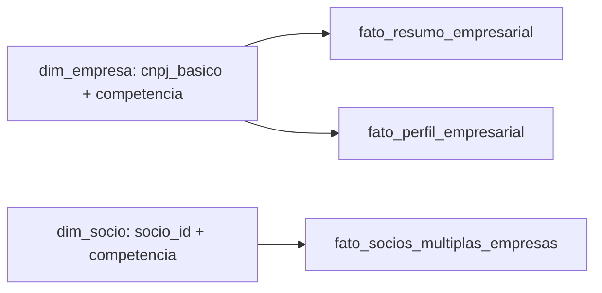

# Parquets: tipos, relacionamentos e visões históricas

Este é o dicionário dos dados implementados em [Esquemas.py](Scripts/Pipeline/Esquemas.py), [PipelinePrata.py](Scripts/Pipeline/PipelinePrata.py) e [PipelineOuro.py](Scripts/Pipeline/PipelineOuro.py). Ele descreve os cinco produtos finais da Ouro e resume os três conjuntos da Prata.

As três visões descritas abaixo são formas de consumir os Parquets existentes. Não são novos endpoints nem arquivos adicionais criados pelo pipeline. Todos os números de exemplo são **fictícios**, para demonstrar um histórico de cinco meses.

## 1. Onde estão os dados

Dentro do container, os dados ficam em `/app/DATA`. No Compose padrão, esse caminho corresponde à pasta `DATA` do host; `DIRETORIO_DATA` permite escolher outra pasta do servidor.

```text
DATA/Ouro/
  Metadados.json
  competencia=2026-07/
    dim_empresa/part-*.parquet
    dim_socio/part-*.parquet
    fato_resumo_empresarial/part-*.parquet
    fato_socios_multiplas_empresas/part-*.parquet
    fato_perfil_empresarial/part-*.parquet
  competencia=2026-08/
    ... os mesmos cinco produtos ...
  competencia=2026-09/
    ...
  competencia=2026-10/
    ...
  competencia=2026-11/
    ...
```

Cada produto é uma tabela lógica, que pode estar dividida em vários arquivos. Todos os `part-*.parquet` do mesmo produto e competência formam seu conjunto de registros. `Metadados.json`, `_SUCCESS`, temporários e arquivos de controle não são dados de negócio para importar no BI.

Os cinco produtos de uma competência são publicados juntos depois das validações. Se a carga for interrompida antes de terminar a Prata necessária, a nova Ouro daquele mês ainda não estará disponível. Uma versão mensal já publicada permanece válida até uma substituição concluída.

Para acesso remoto e download com o perfil `analise`, veja [Endpoints_Documentacao.MD](Endpoints_Documentacao.MD). O acesso direto à pasta do host depende das permissões do sistema operacional.

## 2. Como o histórico funciona

`competencia` é o mês do lote publicado pela Receita, no formato `AAAA-MM`. Ela vem da pasta da fonte e representa uma observação mensal do cadastro; não é uma coluna histórica recebida em cada linha do CSV original.

- Novo mês acrescenta uma partição na Prata e na Ouro.
- Correção de um mês já existente substitui os registros afetados daquela competência.
- Outros meses continuam preservados; não há exclusão automática por idade.
- A data de inserção é preservada para uma chave já conhecida dentro daquela competência.
- `data_atualizacao` é auditoria da transformação. Para o eixo histórico, use `competencia`.

O grão de empresa é **CNPJ básico + competência**. Assim, a mesma empresa em cinco meses ocupa cinco linhas em cada fato empresarial, se aparecer nas cinco competências.

Em novembro de 2026, um intervalo de cinco meses inclui julho a novembro. Para descobrir se todos estão disponíveis:

```powershell
docker compose exec app python main.py importar --meses 5 --simular
```

Para uma carga real, retire `--simular`. O programa processa o mês mais antigo por completo antes do seguinte. O padrão continua sendo quatro meses; cinco é apenas o recorte deste exemplo. Um mês ausente na fonte ou ainda não concluído não deve ser apresentado como se tivesse valores zero.

## 3. Convenções de tipos e auditoria

Os tipos abaixo são os tipos lógicos Spark usados na produção/leitura dos Parquets, não uma descrição de sua codificação física interna.

| Tipo | Significado |
|---|---|
| `string` | Texto, incluindo códigos, identificadores e competência |
| `decimal(20,2)` | Número decimal exato, com até 20 dígitos totais e duas casas decimais |
| `bigint` | Inteiro de 64 bits, usado nas contagens |
| `int` | Inteiro de 32 bits, usado no tempo calculado em meses |
| `double` | Número de ponto flutuante, usado na idade média estimada |
| `boolean` | Verdadeiro/falso |
| `date` | Data de negócio, presente na Prata |
| `timestamp` | Data e horário de auditoria; a sessão Spark usa UTC |

CNPJ básico e códigos devem continuar como texto para preservar zeros à esquerda. `cnpj_basico` é a raiz esperada de oito dígitos, compartilhada pelos estabelecimentos da empresa; não é o CNPJ completo de 14 dígitos de uma filial.

Além de `competencia`, descrita em cada tabela, **todos os cinco produtos Ouro** têm estas colunas:

| Coluna | Tipo | O que registra |
|---|---|---|
| `arquivo_origem` | `string` | Referência lógica, como `Prata/competencia=2026-11` |
| `data_insercao` | `timestamp` | Primeira publicação da chave naquela competência, preservada em correções |
| `data_atualizacao` | `timestamp` | Horário da publicação/transformação da versão atual |
| `atualizado_por` | `string` | Responsável informado pela operação |
| `execucao_id` | `string` | Identificador da execução responsável pela saída |

As chaves dos produtos Ouro são validadas como não nulas e únicas antes da publicação. Outros campos podem ser nulos. `null` significa ausência de observação válida, não necessariamente zero. As definições das próximas seções descrevem essa semântica de negócio; a nulabilidade física inferida ao ler Parquet pode ser mais permissiva.

## 4. Dicionário dos cinco produtos Ouro

### 4.1. dim_empresa

**Grão/chave:** uma linha por `cnpj_basico + competencia`. Contém descrições da empresa naquele retrato mensal. Total: sete colunas abaixo mais cinco colunas comuns de auditoria.

| Coluna | Tipo | Significado |
|---|---|---|
| `cnpj_basico` | `string` | Chave da empresa, preservando zeros |
| `competencia` | `string` | Mês da observação; parte da chave |
| `razao_social` | `string` | Nome empresarial informado no cadastro |
| `natureza_juridica` | `string` | Código de natureza jurídica |
| `qualificacao_responsavel` | `string` | Código da qualificação do responsável |
| `porte_empresa` | `string` | Código do porte cadastrado |
| `ente_federativo_responsavel` | `string` | Informação de ente federativo, quando preenchida |

Os códigos são preservados; suas tabelas auxiliares de descrição não são dimensões adicionais desta versão. O nome pode mudar entre competências, por isso a junção histórica inclui o mês.

### 4.2. dim_socio

**Grão/chave:** uma linha por `socio_id + competencia`. Total: nove colunas abaixo mais cinco de auditoria.

| Coluna | Tipo | Significado |
|---|---|---|
| `socio_id` | `string` | Hash SHA-256 textual da identificação aproximada |
| `competencia` | `string` | Mês da observação; parte da chave |
| `identificador_socio` | `string` | Tipo do sócio; o cálculo de idade considera `2` como pessoa física |
| `documento_mascarado` | `string` | Documento conforme tratamento da fonte; CPF permanece mascarado |
| `nome_socio` | `string` | Nome do sócio escolhido entre os vínculos da competência |
| `nome_normalizado` | `string` | Nome em maiúsculas, com espaços internos repetidos normalizados |
| `pais` | `string` | Código de país, quando disponível |
| `faixa_etaria` | `string` | Código de faixa etária do registro representativo escolhido |
| `identificacao_aproximada` | `boolean` | `true` nesta versão: a identificação não é inequívoca |

O hash usa tipo, documento e nome normalizado; sem documento, inclui também país. Ele não recupera CPF nem elimina possíveis colisões de identificação. Alterações desses atributos podem produzir outro `socio_id` em um mês posterior. A mesma pessoa não tem continuidade histórica garantida apenas pelo hash.

Como há vários vínculos possíveis, os atributos da dimensão são escolhidos por deduplicação determinística. A idade média empresarial é calculada a partir dos vínculos Prata da empresa, não pela faixa de uma dimensão já consolidada entre empresas.

### 4.3. fato_resumo_empresarial

**Grão/chave:** uma linha por `cnpj_basico + competencia`. Total: seis colunas abaixo mais cinco de auditoria.

| Coluna | Tipo | Cálculo/definição |
|---|---|---|
| `cnpj_basico` | `string` | Empresa da observação |
| `competencia` | `string` | Mês da observação |
| `quantidade_estabelecimentos` | `bigint` | Contagem de estabelecimentos deduplicados da empresa naquele mês |
| `estabelecimentos_ativos` | `bigint` | Contagem com situação cadastral `02` ou `2` |
| `quantidade_socios` | `bigint` | Contagem de vínculos societários aproximados deduplicados da empresa |
| `capital_social` | `decimal(20,2)` | Capital social cadastrado da empresa naquele mês |

Estabelecimentos e sócios são agregados separadamente antes de juntá-los à empresa. Assim, três estabelecimentos e dois sócios não viram seis linhas com capital repetido.

Se não houver observação correspondente de estabelecimentos/sócios, as contagens da relação ficam nulas. Com estabelecimentos observados, nenhum ativo resulta em zero na contagem de ativos. Somar `quantidade_socios` entre empresas conta participações/vínculos, não pessoas distintas.

### 4.4. fato_socios_multiplas_empresas

**Grão/chave:** uma linha por `socio_id + competencia`, somente quando a contagem for pelo menos dois. Total: três colunas abaixo mais cinco de auditoria.

| Coluna | Tipo | Cálculo/definição |
|---|---|---|
| `socio_id` | `string` | Identificação aproximada; relaciona com `dim_socio` |
| `competencia` | `string` | Mês da observação |
| `quantidade_empresas` | `bigint` | Quantidade de CNPJs básicos distintos vinculados ao sócio naquele mês |

Inclui os tipos de sócio presentes no cadastro, não apenas pessoas físicas. O filtro é `quantidade_empresas >= 2`. A ausência de uma linha nesse fato não representa automaticamente zero empresas.

Este produto contém a quantidade, mas não a lista dos CNPJs de cada sócio. A relação detalhada sócio/empresa está na Prata. Não há uma ponte societária adicional na Ouro nesta versão; a role de análise não recebe acesso HTTP à Prata.

### 4.5. fato_perfil_empresarial

**Grão/chave:** uma linha por `cnpj_basico + competencia`. Total: cinco colunas abaixo mais cinco de auditoria.

| Coluna | Tipo | Cálculo/definição |
|---|---|---|
| `cnpj_basico` | `string` | Empresa da observação |
| `competencia` | `string` | Mês da observação |
| `meses_desde_abertura_matriz` | `int` | Piso dos meses entre o fim da competência e a menor abertura válida de matriz |
| `idade_media_estimada_socios_pf` | `double` | Média dos pontos médios das faixas válidas dos sócios PF da empresa |
| `capital_social` | `decimal(20,2)` | Capital social cadastrado naquele mês |

Para abertura, considerar matriz identificada por `1` ou `01`, com data não posterior ao fim da competência. Na ausência de abertura válida, o tempo fica nulo. Esse indicador mede tempo desde a abertura, não tempo efetivamente em situação ativa.

Idades estimadas usadas pelo código:

| Faixa | Valor usado na média |
|---|---:|
| `1` | 6,0 |
| `2` | 16,5 |
| `3` | 25,5 |
| `4` | 35,5 |
| `5` | 45,5 |
| `6` | 55,5 |
| `7` | 65,5 |
| `8` | 75,5 |
| `9`, acima de 80 | 87,0 |
| `0`, ausente ou desconhecida | Não entra na média |

Pessoas jurídicas e demais tipos diferentes de PF também ficam fora da média. O resultado fica nulo quando não há PF com faixa válida. Não se soma idade e não se interpreta o ponto médio como idade exata da pessoa.

## 5. Relacionamentos e cuidados de agregação



| Origem | Destino | Colunas da junção |
|---|---|---|
| `dim_empresa` | `fato_resumo_empresarial` | `cnpj_basico` e `competencia` |
| `dim_empresa` | `fato_perfil_empresarial` | `cnpj_basico` e `competencia` |
| `dim_socio` | `fato_socios_multiplas_empresas` | `socio_id` e `competencia` |

No grão atual, dimensão e fato empresarial têm uma linha por empresa/mês, portanto a correspondência pela chave completa é 1:1. O fato de múltiplas empresas contém apenas um subconjunto das chaves da dimensão de sócios.

Juntar apenas por CNPJ ou sócio ao combinar cinco meses cruza competências diferentes e multiplica observações. No Power BI, crie chaves textuais concatenadas nas duas tabelas de cada relação, por exemplo `cnpj_basico & "|" & competencia` e `socio_id & "|" & competencia`.

| Medida | Como consumir |
|---|---|
| Quantidade de empresas | Contar linhas do resumo dentro de cada competência |
| Estabelecimentos/ativos | Somar contagens entre empresas no mesmo mês |
| Participações societárias | Somar `quantidade_socios`, identificando que são vínculos e não sócios únicos |
| Capital social total | Somar uma observação por empresa no mesmo mês |
| Média de capital social | Aplicar média aos capitais das empresas do grupo/mês; nulos ficam fora |
| Sócios em várias empresas | Contar linhas do fato de múltiplas empresas por competência |
| Idade estimada por empresa | Usar o valor do perfil empresarial daquela competência |

Capital social é uma medida cadastral de estoque, não receita ou faturamento. Sua soma em julho + agosto + setembro não representa uma receita acumulada. O capital aparece em dois fatos para apoiar consultas diferentes; escolha um deles para cada medida, sem somar os dois.

A média das idades médias das empresas é uma **média de empresas**, não a idade média de todas as pessoas. A média global ponderada exigiria a quantidade de PF com idade válida por empresa, denominador que a Ouro atual não publica. `quantidade_socios` inclui outros tipos e faixas desconhecidas, portanto não é esse denominador.

## 6. As três visões com cinco meses

As consultas SQL desta seção são referências de consumo em uma sessão Spark SQL com as tabelas Ouro registradas. A API atual não executa SQL. Exemplos de valores e nomes nesta seção são fictícios.

### 6.1. Visão 1: evolução empresarial mensal

**Pergunta:** como mudaram capital social, estabelecimentos, ativos e sócios de uma empresa entre julho e novembro?

Fonte: `fato_resumo_empresarial`, com descrições de `dim_empresa` pela chave mensal completa.

| Competência | CNPJ básico | Capital social | Estabelecimentos | Ativos | Sócios/vínculos |
|---|---|---:|---:|---:|---:|
| 2026-07 | 00000001 | 100.000,00 | 2 | 2 | 2 |
| 2026-08 | 00000001 | 100.000,00 | 2 | 2 | 2 |
| 2026-09 | 00000001 | 120.000,00 | 3 | 3 | 3 |
| 2026-10 | 00000001 | 120.000,00 | 3 | 2 | 3 |
| 2026-11 | 00000001 | 150.000,00 | 4 | 3 | 3 |

```sql
SELECT f.competencia, f.cnpj_basico, d.razao_social,
       f.quantidade_estabelecimentos, f.estabelecimentos_ativos,
       f.quantidade_socios, f.capital_social
FROM fato_resumo_empresarial f
LEFT JOIN dim_empresa d
  ON d.cnpj_basico = f.cnpj_basico AND d.competencia = f.competencia
WHERE f.competencia BETWEEN '2026-07' AND '2026-11'
  AND f.cnpj_basico = '00000001'
ORDER BY f.competencia;
```

Para a visão geral do conjunto de empresas, o agrupamento é mensal:

```sql
SELECT competencia,
       COUNT(*) AS quantidade_empresas,
       SUM(quantidade_estabelecimentos) AS estabelecimentos,
       SUM(estabelecimentos_ativos) AS ativos,
       SUM(quantidade_socios) AS participacoes_societarias,
       SUM(capital_social) AS capital_total,
       AVG(capital_social) AS capital_medio
FROM fato_resumo_empresarial
WHERE competencia BETWEEN '2026-07' AND '2026-11'
GROUP BY competencia
ORDER BY competencia;
```

No BI: eixo `competencia`; linhas de capital médio/total e colunas de contagens. Filtros possíveis com a dimensão: empresa, porte e natureza jurídica. Não há UF/CNAE na dimensão empresarial Ouro atual; esses atributos permanecem nos estabelecimentos da Prata.

### 6.2. Visão 2: sócios em múltiplas empresas

**Pergunta:** em quantas empresas cada sócio aproximado aparece em cada mês, e quais concentram mais vínculos?

Fonte: `fato_socios_multiplas_empresas`, juntando nome/documento de `dim_socio` por `socio_id + competencia`.

| Sócio fictício | 2026-07 | 2026-08 | 2026-09 | 2026-10 | 2026-11 |
|---|---:|---:|---:|---|---:|
| Ana Silva | 2 | 3 | 2 | Sem linha no fato | 4 |

Outubro fica sem linha quando a identificação não passa pelo filtro de duas empresas. Essa ausência, isoladamente, não deve virar zero nem ser tratada como prova de saída de todas as empresas.

```sql
SELECT f.competencia, f.socio_id, d.nome_socio, d.documento_mascarado,
       f.quantidade_empresas
FROM fato_socios_multiplas_empresas f
LEFT JOIN dim_socio d
  ON d.socio_id = f.socio_id AND d.competencia = f.competencia
WHERE f.competencia BETWEEN '2026-07' AND '2026-11'
ORDER BY f.socio_id, f.competencia;
```

No BI: matriz de sócio nas linhas, competência nas colunas e quantidade de empresas nos valores; ranking por mês. Use a identificação aproximada para relacionar, não apenas o nome exibido. Comparações entre meses continuam sujeitas à estabilidade do nome e documento usados no hash.

### 6.3. Visão 3: perfil empresarial e capital social

**Pergunta:** como evoluem tempo desde abertura, perfil etário estimado dos sócios e capital social da empresa?

Fonte: `fato_perfil_empresarial`, com descrições de `dim_empresa`. Exemplo para a empresa fictícia 00000001:

| Competência | Meses desde abertura da matriz | Idade média estimada PF | Capital social |
|---|---:|---:|---:|
| 2026-07 | 78 | 35,50 | 100.000,00 |
| 2026-08 | 79 | 35,50 | 100.000,00 |
| 2026-09 | 80 | 38,83 | 120.000,00 |
| 2026-10 | 81 | 38,83 | 120.000,00 |
| 2026-11 | 82 | 38,83 | 150.000,00 |

Idades foram arredondadas apenas na apresentação; o campo armazenado é `double`. A mudança de média pode refletir alteração de vínculos ou de faixas, não envelhecimento mensal exato das pessoas.

```sql
SELECT f.competencia, f.cnpj_basico, d.razao_social,
       f.meses_desde_abertura_matriz,
       f.idade_media_estimada_socios_pf, f.capital_social
FROM fato_perfil_empresarial f
LEFT JOIN dim_empresa d
  ON d.cnpj_basico = f.cnpj_basico AND d.competencia = f.competencia
WHERE f.competencia BETWEEN '2026-07' AND '2026-11'
  AND f.cnpj_basico = '00000001'
ORDER BY f.competencia;
```

No BI: série mensal para uma empresa; dispersão de capital versus idade média estimada, com competência e porte como filtros. A média de capital social por grupo/mês é calculada no consumo. Não existe uma coluna `media_receita` nem `media_capital_social` materializada por CNPJ: por empresa/mês há um valor de capital social.

## 7. Reunir as cinco competências para consulta

### 7.1. Exemplo em uma sessão PySpark

Execute em ambiente com PySpark configurado e somente depois de as cinco competências do exemplo estarem publicadas. A raiz pode ser o caminho montado no container ou a pasta Ouro acessível no host.

```python
from pathlib import Path
from Scripts.Pipeline.PipelinePrata import criar_spark

raiz_ouro = Path("/app/DATA/Ouro")  # Ajuste se executar fora do container.
meses = ["2026-07", "2026-08", "2026-09", "2026-10", "2026-11"]
produtos = [
    "dim_empresa", "dim_socio", "fato_resumo_empresarial",
    "fato_socios_multiplas_empresas", "fato_perfil_empresarial",
]

spark = criar_spark()
try:
    for produto in produtos:
        pastas = [raiz_ouro / f"competencia={mes}" / produto for mes in meses]
        if not all(pasta.is_dir() for pasta in pastas):
            raise FileNotFoundError(f"Faltam competências publicadas de {produto}")
        tabela = (spark.read.option("recursiveFileLookup", "true")
                  .parquet(*[str(pasta) for pasta in pastas]))
        tabela.createOrReplaceTempView(produto)

    # As demais consultas da seção 6 também podem ser executadas aqui.
    spark.sql("""
        SELECT competencia, COUNT(*) AS empresas,
               AVG(capital_social) AS capital_medio
        FROM fato_resumo_empresarial
        GROUP BY competencia
        ORDER BY competencia
    """).show(truncate=False)
finally:
    spark.stop()
```

Esse exemplo lê e consulta saídas existentes; não inicia downloads nem materializa novas tabelas. O código não deve apontar para staging ou `.anterior`.

### 7.2. Exemplo no Power BI/Power Query

Use uma consulta por produto. Para um arquivo individual, existe o conector Parquet; para reunir as partes e competências, use uma pasta acessível e transforme os conteúdos. O conector Parquet documenta suporte a arquivos locais, Azure Blob e ADLS Gen2; uma URL HTTP arbitrária não é uma fonte equivalente para Parquets grandes. [Conector Parquet](https://learn.microsoft.com/pt-br/power-query/connectors/parquet).

Em **Obter dados -> Consulta em branco -> Editor avançado**, ajuste a raiz absoluta e o produto neste exemplo M. Preserve a estrutura `competencia=.../produto/` se tiver baixado os arquivos do servidor.

```powerquery
let
    RaizOuro = "C:\CAMINHO\DATA\Ouro",
    Produto = "fato_resumo_empresarial",
    Meses = {"2026-07", "2026-08", "2026-09", "2026-10", "2026-11"},
    Arquivos = Folder.Files(RaizOuro),
    Selecionados = Table.SelectRows(Arquivos, each
        let
            Caminho = Text.Replace([Folder Path], "\", "/")
        in
            [Extension] = ".parquet" and
            List.AnyTrue(List.Transform(Meses, (Mes) =>
                Text.EndsWith(Caminho, "/competencia=" & Mes & "/" & Produto & "/")))
    ),
    Tabelas = List.Transform(Selecionados[Content], each Parquet.Document(_)),
    Resultado = if List.IsEmpty(Tabelas)
                then error "Nenhum Parquet publicado encontrado para o produto e meses."
                else Table.Combine(Tabelas)
in
    Resultado
```

O filtro seleciona somente a pasta final do produto em cada mês informado, excluindo outros produtos, manifestos e pastas de staging/backup. Confirme se todas as cinco competências estão presentes: o exemplo combina as encontradas e não fabrica dados para uma competência ausente. `Folder.Files` percorre subpastas e exige um caminho absoluto. [Referência Folder.Files](https://learn.microsoft.com/en-us/powerquery-m/folder-files).

Tipos para conferir no modelo:

| Colunas | Tratamento no BI |
|---|---|
| CNPJ, códigos, nomes, hashes e `competencia` | Texto |
| Contagens e meses desde abertura | Número inteiro |
| Idade média estimada | Número decimal |
| Identificação aproximada | Verdadeiro/falso |
| Datas de auditoria | Data/hora, mantendo a convenção UTC documentada |
| Capital social | Validar precisão e faixa de valores antes da conversão |

O decimal fixo do Power BI corresponde a `decimal(19,4)`, com faixa menor que a permitida por `decimal(20,2)` do Spark; o decimal de ponto flutuante tem aproximadamente 15 dígitos de precisão. Escolha a conversão do capital depois de validar seus valores, sem presumir equivalência exata entre esses tipos. [Tipos de dados no Power BI](https://learn.microsoft.com/pt-br/power-bi/connect-data/desktop-data-types).

Para a linha do tempo, derive uma data do primeiro dia de cada `competencia` e use-a para ordenar/exibir os meses. Preserve a competência textual para os relacionamentos. Acesso do Power BI Service a uma pasta privada do servidor exige a configuração de conectividade/gateway apropriada; ele não acessa automaticamente o diretório interno de um container. [Gateway de dados](https://learn.microsoft.com/pt-br/power-bi/connect-data/service-gateway-onprem).

## 8. Referência dos três Parquets lógicos da Prata

Prata é a camada detalhada, com acesso HTTP de engenharia. Os fragmentos físicos são organizados por entidade, competência e origem ZIP:

```text
DATA/Prata/empresas/competencia=2026-11/Empresas0/part-*.parquet
DATA/Prata/estabelecimentos/competencia=2026-11/Estabelecimentos0/part-*.parquet
DATA/Prata/socios/competencia=2026-11/Socios0/part-*.parquet
```

Cada fragmento é deduplicado na própria origem. `PipelinePrata.ler_tabela(...)` consolida e deduplica também entre origens; ler todos os fragmentos diretamente sem essa regra pode repetir candidatos da mesma chave. A Ouro usa a leitura lógica consolidada.

Todas as tabelas Prata acrescentam `competencia: string` e as cinco colunas comuns de auditoria descritas na seção 3. Na Prata, `arquivo_origem` identifica o ZIP, como `Empresas0.zip`.

| Tabela | Chave lógica | Quantidade de colunas, com auditoria |
|---|---|---:|
| `empresas` | `cnpj_basico + competencia` | 13 |
| `estabelecimentos` | `cnpj_completo + competencia` | 37 |
| `socios` | `cnpj_basico + socio_id + competencia` | 20 |

### 8.1. empresas

| Tipo | Colunas de negócio |
|---|---|
| `string` | `cnpj_basico`, `razao_social`, `natureza_juridica`, `qualificacao_responsavel`, `porte_empresa`, `ente_federativo_responsavel` |
| `decimal(20,2)` | `capital_social` |

### 8.2. estabelecimentos

| Tipo | Colunas de negócio e derivadas |
|---|---|
| `string` | `cnpj_basico`, `cnpj_ordem`, `cnpj_dv`, `identificador_matriz_filial`, `nome_fantasia`, `situacao_cadastral`, `motivo_situacao_cadastral`, `nome_cidade_exterior`, `pais`, `cnae_fiscal_principal`, `cnae_fiscal_secundaria`, `tipo_logradouro`, `logradouro`, `numero`, `complemento`, `bairro`, `cep`, `uf`, `municipio`, `ddd_1`, `telefone_1`, `ddd_2`, `telefone_2`, `ddd_fax`, `fax`, `correio_eletronico`, `situacao_especial`, `cnpj_completo` |
| `date` | `data_situacao_cadastral`, `data_inicio_atividade`, `data_situacao_especial` |

`cnpj_completo` é a concatenação textual de `cnpj_basico + cnpj_ordem + cnpj_dv`. CNAEs secundários permanecem no campo textual da fonte, sem uma tabela filha adicional nesta versão.

### 8.3. socios

| Tipo | Colunas de negócio e derivadas |
|---|---|
| `string` | `cnpj_basico`, `identificador_socio`, `nome_socio`, `documento_mascarado`, `qualificacao_socio`, `pais`, `representante_legal`, `nome_representante`, `qualificacao_representante_legal`, `faixa_etaria`, `nome_normalizado`, `socio_id` |
| `date` | `data_entrada_sociedade` |
| `boolean` | `identificacao_aproximada` |

Datas inválidas viram nulas; textos vazios são normalizados para nulo. A regra de deduplicação prefere nome preenchido, capital preenchido quando aplicável e menor quantidade de campos de negócio nulos, com desempate determinístico. Capital maior não é um critério de qualidade.

## 9. Limites para interpretar os resultados

- Cinco competências são cinco retratos mensais, não um histórico diário de todas as alterações cadastrais.
- O histórico disponível depende dos lotes existentes na fonte e das competências concluídas no pipeline.
- Capital social não substitui faturamento observado; esta base não fornece a receita solicitada na ideia inicial.
- A identidade de sócio e sua idade são aproximações com as limitações descritas acima.
- A Ouro atual não contém a lista das empresas de cada sócio, dimensão de estabelecimento ou descrições completas das tabelas auxiliares.
- Os exemplos históricos e gráficos possíveis deste documento não significam que cinco meses já foram carregados. Confira as publicações em `Ouro/Metadados.json` e na listagem autorizada da API.
