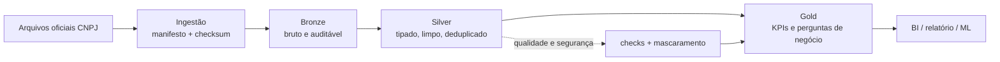
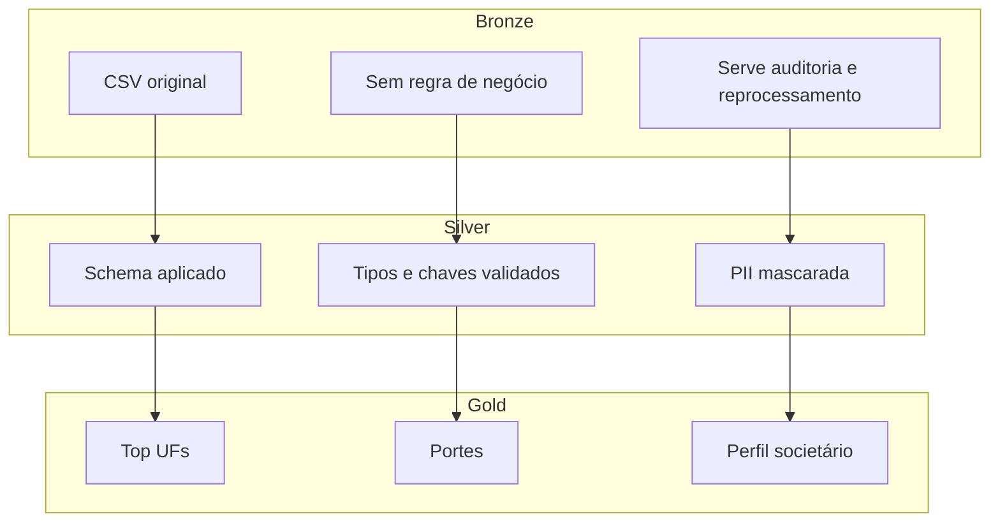
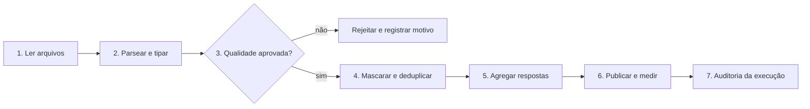
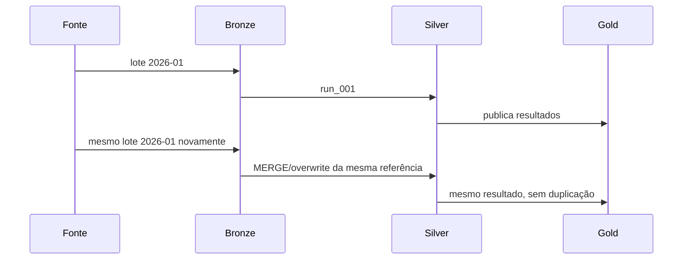
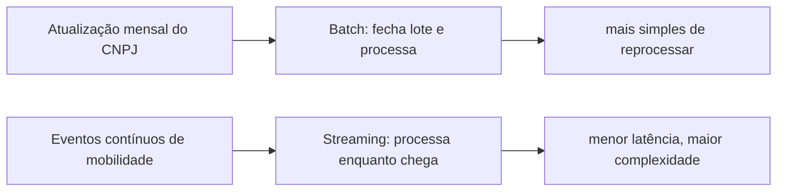

# Conceitos visuais

## 1. Fluxo principal do lakehouse

**Como explicar:** Bronze preserva a verdade original; Silver organiza e protege; Gold entrega uma resposta pronta para consumo. Se a Gold estiver errada, voltamos à Silver e, se necessário, à Bronze para reprocessar.

## 2. O que muda em cada camada

## 3. Pipeline como linha de montagem

## 4. Por que reprocessamento precisa ser idempotente

## 5. Batch do CNPJ versus streaming

O trabalho CNPJ é naturalmente batch. Kafka e Structured Streaming aparecem na aula como repertório de arquitetura; não precisam ser adicionados ao Cenário A sem uma necessidade real de baixa latência.
